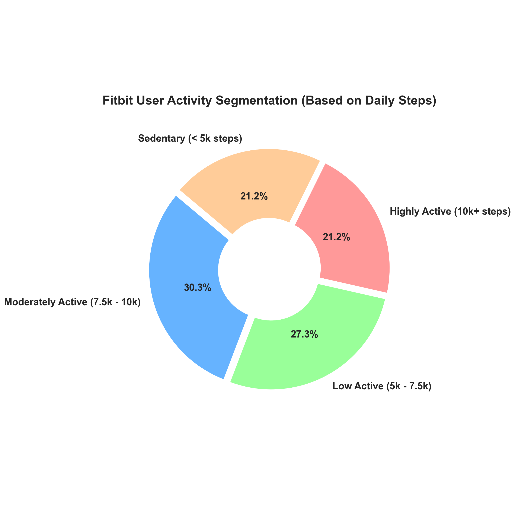
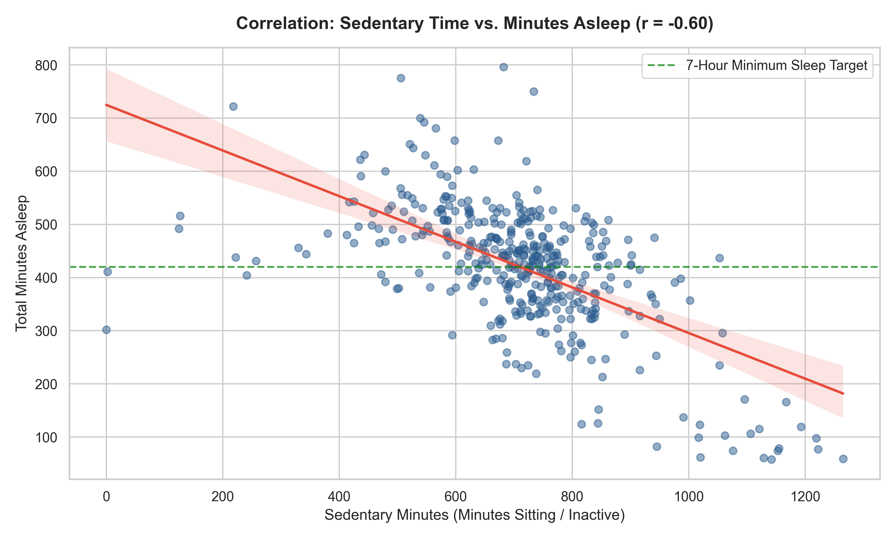
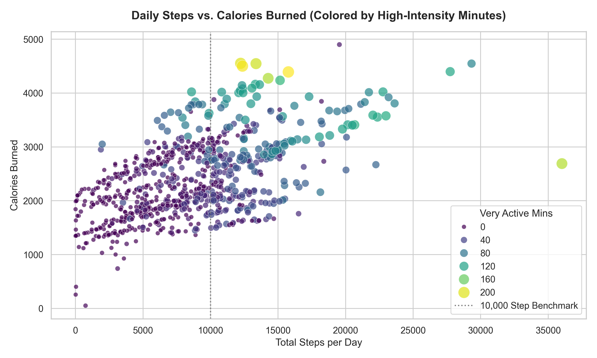
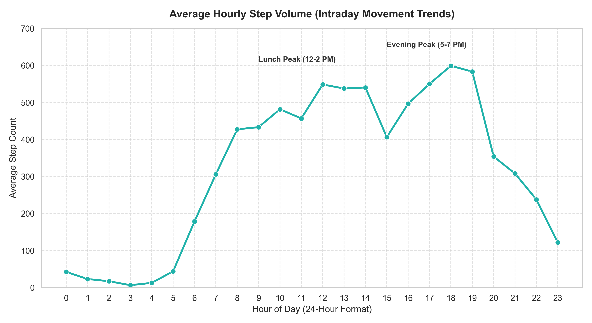

# Bellabeat Consumer Wellness Tracker Analysis
**Google Data Analytics Professional Certificate Capstone Project (Case Study 2)**  
**Author:** Sanju Stephen  
**Tools Used:** Python (pandas, numpy, matplotlib, seaborn), Jupyter Notebook, Git & GitHub  
**Dataset:** [Fitbit Fitness Tracker Data (Kaggle - Mobius)](https://www.kaggle.com/datasets/arashnic/fitbit)

---

## Executive Summary
Bellabeat is a high-tech manufacturer of health-focused smart devices engineered specifically for women. Since its founding in 2013, the company has paired stylish, jewelry-inspired tracking hardware (such as the *Bellabeat Leaf* tracker and *Time* wellness watch) with proprietary biometric algorithms via the *Bellabeat App* to monitor activity, sleep, stress, and reproductive cycles.

To unlock new growth opportunities, **Urška Sršen** (Co-founder and Chief Creative Officer) commissioned this analysis of smart device fitness data from external consumers (Fitbit cohort). By analyzing real-world patterns across daily physical activity, sedentary behavior, intraday movement cadence, and sleep duration, this study delivers data-driven growth recommendations to position Bellabeat's hardware and digital subscription services ahead of mass-market competitors.

---

## 1. Ask Phase

### Business Task
Analyze non-Bellabeat smart fitness tracker data to uncover core behavioral patterns regarding daily activity, sleep duration, sedentary habits, and intensity. Translate these trends into high-impact marketing, product feature, and digital engagement strategies for Bellabeat's wearable lines and membership app.

### Key Stakeholders
- **Urška Sršen:** Co-founder and Chief Creative Officer, leading product design, creative direction, and brand expansion.
- **Sando Mur:** Co-founder and key executive member, overseeing commercial scale and strategic initiatives.
- **Bellabeat Marketing Analytics Team:** Responsible for consumer insights, channel performance, and digital campaign execution.

### Guiding Questions
1. What are some identifiable trends in smart device usage?
2. How could these behavioral trends apply to Bellabeat customers?
3. How could these trends help shape Bellabeat's marketing strategy and app features?

---

## 2. Prepare Phase

### Data Source & Architecture
- **Dataset:** Fitbit Fitness Tracker Data published by Mobius on Kaggle under CC0 Public Domain.
- **Monitoring Period:** April 12, 2016 – May 12, 2016 (30-day tracking window, MTurk cohort).
- **Files Ingested:**
  - `dailyActivity_merged.csv`: 940 daily records covering steps, distance, active minutes, and calories.
  - `sleepDay_merged.csv`: 413 sleep logs recording sleep duration and time in bed.
  - `hourlySteps_merged.csv`: 22,099 hourly records tracking intraday movement.
  - `weightLogInfo_merged.csv`: Evaluated for compliance (only 8 unique users; excluded from primary statistical modeling due to severe sample attrition).

### ROCCC Data Assessment & Analytical Limitations
- **Reliable (Medium/Low):** Small sample size (33 unique users for activity, only 24 users for sleep, and 8 users for weight).
- **Original (Low):** Third-party dataset collected via Amazon Mechanical Turk survey respondents rather than directly via primary first-party infrastructure.
- **Comprehensive (Medium):** Tracks steps, intensity, calories, and sleep down to hourly intervals, but lacks demographic metadata (such as gender and age).
- **Current (Low):** Collected in 2016; physical fitness tracking and smartwatch adoption have expanded significantly since.
- **Cited (High):** Publicly available via Kaggle with open documentation.

> **Data Limitation Note for Stakeholders:** Because Bellabeat specifically designs wellness technology for women, the lack of demographic indicators (gender) in this Fitbit sample represents a structural limitation. Findings are treated as general fitness tracker habits and mapped specifically to Bellabeat's female consumer profile.

---

## 3. Process Phase

Data cleaning, deduplication, feature engineering, and table unification were performed in **Python** using `pandas`.

### Cleaning Steps & Transformation Rules
1. **Deduplication:**
   - Evaluated duplicate records across all datasets.
   - Identified and removed **3 duplicate entries** in `sleepDay_merged.csv` (dropping records from 413 to 410).
2. **Anomaly & Non-Wear Filtering:**
   - Identified **77 records with `totalsteps == 0`** in daily activity. These indicate days where the tracker was left on a nightstand or battery depleted, which skew daily behavioral averages. Filtered these out, retaining **863 valid active-wear days**.
3. **Data Type Standardization:**
   - Standardized column headers to lowercase strings.
   - Parsed date columns (`activitydate`, `sleepday`, `activityhour`) from generic text strings into native `datetime64` objects.
4. **Feature Engineering:**
   - `day_of_week`: Derived weekday names to track cadence across workdays vs. weekends.
   - `time_awake_in_bed`: Computed as `totaltimeinbed - totalminutesasleep` to quantify sleep latency and restlessness.
   - `hour`: Extracted integer hour (0–23) from hourly timestamps to analyze peak daily movement windows.
5. **Inner Join Merge:**
   - Merged `daily_activity_cleaned` and `daily_sleep` on `['id', 'activitydate']`, generating 410 synchronized records across 24 distinct participants for correlation and multi-variable analysis.

The complete code implementation is organized in [`notebooks/bellabeat_analysis.ipynb`](notebooks/bellabeat_analysis.ipynb).

---

## 4. Analyze Phase

Descriptive statistical analysis and user segmentation uncovered several key behavioral drivers:

### 1. High-Level Summary Statistics
| Metric | Mean | Median (50%) | Benchmark Target | Status |
| :--- | :--- | :--- | :--- | :--- |
| **Daily Steps** | 8,319 steps | 8,053 steps | 10,000 steps/day (CDC/WHO) | Below Benchmark |
| **Sedentary Time** | 955.8 min (~15.9 hrs) | 1,021 min (~17.0 hrs) | < 480 min (8 hrs) | Highly Sedentary |
| **Very Active Time** | 23.0 min | 7.0 min | 30.0 min/day | Below Benchmark |
| **Total Sleep** | 419.2 min (~7.0 hrs) | 432.5 min (~7.2 hrs) | 420–540 min (7–9 hrs) | Borderline Low |
| **Awake in Bed** | 39.3 min | 25.5 min | < 20 min | High Latency |

### 2. User Activity Segmentation
Users were segmented based on their daily step volume:
- **Moderately Active (7,500 – 9,999 steps):** **30.3%**
- **Low Active (5,000 – 7,499 steps):** **27.3%**
- **Highly Active (10,000+ steps):** **21.2%**
- **Sedentary (< 5,000 steps):** **21.2%**

> **Insight:** **78.8% of users fail to hit the traditional 10,000-step target.** The largest user cluster sits between 5,000 and 10,000 steps, demonstrating that realistic, incremental micro-goals resonate far better than a rigid 10,000-step ceiling.

### 3. Correlation Findings
- **Sedentary Time vs. Sleep Duration ($r = -0.60$):** A strong negative correlation. Excessive daytime inactivity is directly associated with shorter sleep duration. When daily sedentary time exceeds ~750 minutes (12.5 hours), average sleep drops below the 7-hour minimum.
- **Very Active Minutes vs. Calories ($r = 0.61$):** High-intensity movement drives energy expenditure far more efficiently than total steps alone ($r = 0.41$).
- **Awake in Bed vs. Calories ($r = -0.29$):** Restlessness and long bedtime latency correspond with lower overall daily physical exertion.

---

## 5. Share Phase: Key Visualizations

All figures were generated programmatically in Python using `matplotlib` and `seaborn` and exported to `visuals/`.

### 1. User Activity Segmentation
Nearly 80% of users fall short of 10,000 daily steps, with the majority clustering in the moderate and low active categories.



---

### 2. Sedentary Minutes vs. Sleep Duration
Prolonged daytime sitting directly compresses sleep duration. The regression trend dips below the 7-hour target threshold as sedentary time expands past 750 minutes.



---

### 3. Daily Steps vs. Calories Burned by Intensity
Caloric burn has a baseline floor of ~1,500–2,000 kcal (BMR). Peak energy burn (>3,500 kcal) is concentrated among days featuring elevated high-intensity minutes (bright yellow points), proving that workout intensity outperforms casual step accumulation.



---

### 4. Hourly Step Cadence (Peak Activity Windows)
Step volume remains stagnant throughout the morning, experiencing a modest spike during lunch (12:00 PM – 2:00 PM) before reaching its peak between 5:00 PM and 7:00 PM (evening post-work window).



---

## 6. Act Phase: Strategic Recommendations

Based on these behavioral findings, the following marketing and product strategies are recommended for Urška Sršen and Bellabeat's leadership:

### 1. Rebrand the Step Target: Introduce "Dynamic Micro-Milestones"
- **Data Justification:** 78.8% of users do not achieve 10,000 steps daily, yet 57.6% walk between 5,000 and 9,999 steps. Enforcing an arbitrary 10k target creates user fatigue and churn.
- **Product Strategy:** In the **Bellabeat App**, replace the static 10,000-step goal with personalized adaptive milestones (e.g., leveling up from 6,000 to 8,000 steps).
- **Marketing Strategy:** Launch an educational social campaign: *"Redefining 10k: Celebrating Sustainable Movement for Women."* Position the *Bellabeat Leaf* as a supportive, guilt-free wellness companion that honors every stage of a woman's routine.

### 2. Smart Inactivity & Bedtime Readiness Alerts
- **Data Justification:** Sedentary minutes average ~15.9 hours/day, and high sedentary time exhibits a strong inverse correlation with sleep duration ($r = -0.60$). Furthermore, users spend an average of ~39 minutes awake in bed.
- **Product Strategy:** Deploy two automated features in the Bellabeat App:
  - **Afternoon Desk-Break Vibrations:** Gentle haptic reminders on the *Bellabeat Time* watch at 2:00 PM and 4:00 PM to take a 5-minute stretch or light walk.
  - **Sleep Prep Wind-Down:** If sedentary time exceeds 750 minutes by 7:00 PM, send an app notification offering a guided 10-minute mindfulness/breathing meditation to lower sleep latency.
- **Marketing Strategy:** Feature these sleep-syncing tools prominently in ad creatives for the *Bellabeat Leaf* and *Bellabeat App Subscription*, marketing the tracker as a holistic tool that improves nightly rest through daily mindfulness.

### 3. Capitalize on Peak Cadence: 15-Minute "High-Intensity Sprints"
- **Data Justification:** Intraday step volumes peak predictably at 12:00 PM – 2:00 PM and 5:00 PM – 7:00 PM. High-intensity active minutes drive caloric burn far more strongly ($r = 0.61$) than total steps ($r = 0.41$).
- **Product Strategy:** Offer short, on-demand audio and video workout routines (10–15 minutes) inside the Bellabeat membership app scheduled around lunch and post-work hours.
- **Marketing Strategy:** Promote quick midday and post-work fitness routines via TikTok, Instagram Reels, and Bellabeat newsletter series: *"Short on time? A 15-minute post-work workout delivers twice the wellness impact of counting steps."*

---

## Repository Structure

```text
Bellabeat_CS2/
│
├── README.md                          # Comprehensive Capstone Documentation
├── requirements.txt                   # Environment dependencies
│
├── data/
│   ├── raw/                           # 18 original Fitbit CSV files
│   │   ├── dailyActivity_merged.csv
│   │   ├── sleepDay_merged.csv
│   │   └── hourlySteps_merged.csv
│   └── processed/                     # Cleaned & joined datasets
│
├── notebooks/
│   └── bellabeat_analysis.ipynb       # Modular Jupyter Notebook with full Python pipeline
│
└── visuals/                           # High-resolution exported charts (300 DPI)
    ├── 01_user_activity_distribution.png
    ├── 02_sedentary_vs_sleep.png
    ├── 03_steps_vs_calories.png
    └── 04_hourly_step_trends.png