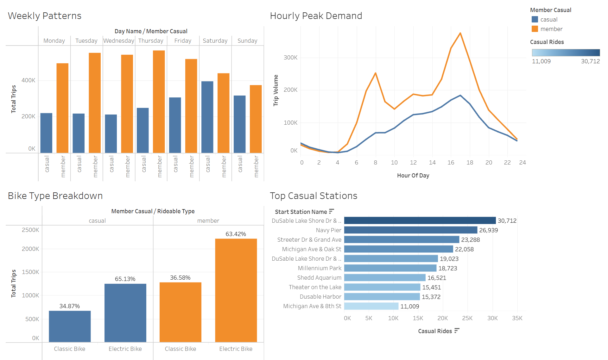

# Cyclistic Bike-Share Case Study: Maximizing Annual Memberships
**Google Data Analytics Professional Certificate Capstone Project**  
**Author:** Sanju Stephen  
**Tools Used:** Google Cloud Storage (GCS), Google BigQuery (SQL), Tableau Public, Git & GitHub  
**Interactive Dashboard:** [View Live Dashboard on Tableau Public](https://public.tableau.com/views/CyclisticBike-ShareRiderBehaviorAnalysis_17927407151230/CyclisticBike-ShareRiderBehaviorAnalysis?:language=en-US&:sid=&:redirect=auth&:display_count=n&:origin=viz_share_link)

---

## Executive Summary
Cyclistic is a bike-share program based in Chicago operating a fleet of more than 5,800 geotracked bicycles across 690 docking stations. The company's marketing director, Lily Moreno, has set a clear organizational objective: **maximize annual memberships to ensure sustainable long-term revenue growth**.

While casual riders already generate transactional revenue through single-ride and full-day passes, financial modeling demonstrates that annual members generate significantly higher lifetime customer value. Rather than conducting an expensive campaign targeting non-riders from scratch, this project analyzes 12 months of historical trip records (5.5M+ rows) to uncover how casual riders and annual members use the system differently. These findings directly inform three actionable marketing campaigns designed to convert existing casual users into subscribers.

---

## 1. Ask Phase

### Business Task
Analyze historical bike trip data to identify core behavioral differences between casual riders and annual members, and develop targeted marketing strategies to convert casual riders into annual subscribers.

### Key Stakeholders
- **Lily Moreno:** Director of Marketing, responsible for campaign strategy, channel allocation, and promotional initiatives.
- **Cyclistic Marketing Analytics Team:** Responsible for processing, analyzing, and synthesizing behavioral patterns into actionable business intelligence.
- **Cyclistic Executive Committee:** Decision-makers with final authority over marketing budgets, pricing tier structures, and operational rollouts.

### Core Guiding Questions
1. How do annual members and casual riders use Cyclistic bikes differently?
2. Why would casual riders purchase Cyclistic annual memberships?
3. How can Cyclistic use digital media, on-site engagement, and subscription tiering to influence casual riders to become members?

---

## 2. Prepare Phase

### Data Source & Storage Architecture
- **Source:** 12 months of historical trip data provided by Motivate International Inc. under a public data license.
- **Raw Dataset Size:** 12 monthly CSV files totaling **5,552,994 raw trip records** (~1.2 GB uncompressed).
- **Cloud Infrastructure:**
  * Raw monthly archives were uploaded to a Google Cloud Storage bucket (`gs://cyclistic-raw-data-cs1/`).
  * Ingestion was executed using BigQuery `LOAD DATA` into the table `casestudies-512405.cyclist_db.trips_raw`.

### ROCCC Quality Evaluation
- **Reliable:** High. Records are operational first-party logs generated directly by automated bike docks and onboard cellular GPS units.
- **Original:** High. Sourced directly from Divvy/Cyclistic operational databases.
- **Comprehensive:** High. Over 5.5 million individual trip logs covering all calendar months, weekdays, weather variations, and rideable types.
- **Current:** High. Encompasses a complete, continuous 12-month operating window.
- **Cited & Licensed:** High. Released under an open data license agreement; stripped of Personally Identifiable Information (PII) to maintain customer privacy.

---

## 3. Process Phase

Data cleaning, validation, and feature engineering were conducted in **Google BigQuery** using SQL.

### Cleaning Rules Applied
1. **False Starts & Maintenance Filtering:** Trips where `ended_at <= started_at` or where total duration was less than 60 seconds were dropped (docking resets, false starts, and technician re-docking).
2. **Outlier / Anomaly Filtering:** Trips exceeding 24 hours (1,440 minutes) were dropped (equipment left unlatched, lost, or stolen).
3. **Feature Engineering:** Derived four key analytical attributes:
   * `ride_length_minutes`: Trip duration calculated as `ROUND(TIMESTAMP_DIFF(ended_at, started_at, SECOND) / 60.0, 2)`.
   * `day_of_week`: Integer representing day of week (1 = Sunday, 7 = Saturday).
   * `day_name`: String representation of the weekday (`Sunday`, `Monday`, etc.).
   * `trip_month`: Formatted `YYYY-MM` string for seasonal trend analysis.

### Data Attrition & Validation Metrics
- **Raw Records Ingested:** 5,552,994
- **Clean Records Retained:** 5,400,008
- **Dropped Records:** 152,986
- **Data Retention Rate:** **97.25%** (2.75% attrition due to dock resets and extreme duration anomalies)

The transformation script is archived in [`SQLTransform/02_data_cleaning.sql`](SQLTransform/02_data_cleaning.sql).

---

## 4. Analyze Phase

Exploratory queries in BigQuery revealed sharp behavioral divides between customer groups across duration, cadence, hours, and geography.

### 1. High-Level Summary Statistics
| Metric | Annual Members | Casual Riders |
| :--- | :--- | :--- |
| **Share of Total Trips** | ~64% | ~36% |
| **Average Trip Duration** | **~12.5 minutes** | **~24.2 minutes** (nearly 2x longer) |
| **Median Trip Duration** | ~9.0 minutes | ~14.5 minutes |
| **Primary Trip Nature** | Utilitarian / Fast Transit | Leisure / Exploration / Exercise |

### 2. Cadence & Commuter vs. Leisure Behavior
- **Weekly Pattern:** Member trip volumes peak Tuesday through Thursday, dropping noticeably over the weekend. Casual riders exhibit the reverse: trip volume surges heavily on Saturday and Sunday.
- **Hourly Demand Curve:**
  * **Annual Members:** Exhibit a distinct **bimodal commute curve** with steep spikes during rush hours at **8:00 AM** and **5:00 PM**, matching standard corporate work shifts.
  * **Casual Riders:** Follow a smooth **unimodal curve** that builds gradually throughout the morning, peaking during the afternoon between **2:00 PM and 5:00 PM**.

### 3. Equipment & Geographic Concentration
- **Bike Type Distribution:** Both groups utilize classic pedal bikes and electric bikes, with electric bikes making up roughly 63% to 65% of rides for both member and casual segments.
- **Geographic Distribution:** Members begin rides evenly across suburban transit nodes, train stations, and central business districts. Casual riders cluster heavily near lakefront parks, tourist landmarks, and waterfront recreation paths:
  1. *DuSable Lake Shore Dr & Monroe St* (~30.7K rides)
  2. *Navy Pier* (~26.9K rides)
  3. *Streeter Dr & Grand Ave* (~23.3K rides)
  4. *Michigan Ave & Oak St* (~22.1K rides)
  5. *DuSable Lake Shore Dr & North Blvd* (~19.0K rides)

All aggregation scripts are documented in [`SQLTransform/03_exploratory_analysis.sql`](SQLTransform/03_exploratory_analysis.sql).

---

## 5. Share Phase

To translate SQL query findings into an intuitive visual format, the summarized datasets were visualized in **Tableau Public** as an interactive 4-panel dashboard.


*(Interactive version: [Access the Live Tableau Dashboard](https://public.tableau.com/views/CyclisticBike-ShareRiderBehaviorAnalysis_17927407151230/CyclisticBike-ShareRiderBehaviorAnalysis?:language=en-US&:sid=&:redirect=auth&:display_count=n&:origin=viz_share_link))*

### Visual Architecture
1. **Weekly Patterns (Grouped Bar Chart):** Visualizes weekday commuter dominance by annual members versus weekend surge by casual riders.
2. **Hourly Peak Demand (Dual Line Chart):** Contrasts the member commuter spikes (8 AM & 5 PM) against the unimodal casual leisure curve.
3. **Bike Type Breakdown (Grouped Bar Chart):** Compares classic versus electric bike adoption across both rider categories.
4. **Top Casual Stations (Ranked Horizontal Bar Chart):** Identifies the highest-volume waterfront and recreational docks for targeted outreach.

---

## 6. Act Phase: Strategic Recommendations

To address the core questions posed by Lily Moreno and the executive committee, the following three data-driven marketing strategies are recommended:

### Recommendation 1: Launch a "Weekend & Leisure" Membership Tier
* **Data Evidence:** Casual riders ride primarily on weekends and take trips that average 24.2 minutes (nearly double member duration). Many do not commute by bike daily and find a standard full-price commuter annual pass uneconomical.
* **Strategic Action:** Introduce a lower-friction **"Weekend & Leisure Annual Pass"** at a reduced annual price. This membership includes unlimited weekend access (Friday 5 PM to Sunday midnight) and discounted per-minute rates on weekdays.
* **Expected Impact:** Directly addresses price resistance for non-commuters and converts one-off weekend riders into predictable recurring annual revenue.

### Recommendation 2: Geo-Targeted Lakefront In-App Triggers & Out-of-Home Marketing
* **Data Evidence:** Casual usage is concentrated heavily across waterfront and recreational stations along Lake Shore Drive, Navy Pier, and Millennium Park.
* **Strategic Action:**
  * **On-Site Conversion:** Install physical QR-code conversion signage directly onto docks and kiosks at the top 5 casual stations.
  * **In-App Conversion:** Deploy automated geofenced push notifications triggered when a casual user finishes a ride at a lakefront dock: *"Turn today's ride into an annual membership: apply 100% of today's day-pass cost toward an annual membership within 24 hours."*
* **Expected Impact:** Engages high-intent riders immediately after a completed ride experience when customer satisfaction and perceived utility are highest.

### Recommendation 3: Multi-Channel Digital Media Campaign & Summer Loyalty Milestones
* **Data Evidence:** Casual riding peaks sharply between May and September and demonstrates heavy electric bike adoption. Casual users already interact with Cyclistic's app and digital checkouts.
* **Strategic Action:**
  * **Social Media Targeting:** Run geo-targeted Instagram, TikTok, and YouTube campaigns throughout Chicago from May to August highlighting scenic waterfront weekend riding, cost-per-ride savings, and electric bike availability.
  * **Email Retargeting:** Retarget casual users who register an email address to buy single-ride or day passes with automated email sequences comparing their cumulative pay-as-you-go spend against the price of an annual plan.
  * **Summer Loyalty Incentive:** Offer 60 minutes of complimentary electric bike ride credits each month for members who sign up during the peak summer promotional window.
* **Expected Impact:** Leverages digital media channels during peak warm-weather months to nurture casual users into subscribers before the winter off-season.

---

## Repository Structure

```text
CyclisticBikeShare_CS1/
│
├── .gitignore               # Excludes large raw data files and OS metadata
├── README.md                # Comprehensive project documentation (Google 6-Phase)
│
├── OriginalData/            # Stored locally only (12 raw CSV files, ~1.2 GB)
│
├── SummarizedData/          # Aggregated, lightweight CSV outputs from BigQuery
│   ├── cyclistic_weekly_patterns.csv
│   ├── cyclistic_hourly_traffic.csv
│   ├── cyclistic_bike_types.csv
│   └── cyclistic_top_stations.csv
│
├── SQLTransform/            # Production BigQuery SQL scripts
│   ├── 01_data_ingestion.sql
│   ├── 02_data_cleaning.sql
│   └── 03_exploratory_analysis.sql
│
└── Visuals/                 # Dashboard media assets
    └── dashboard.png